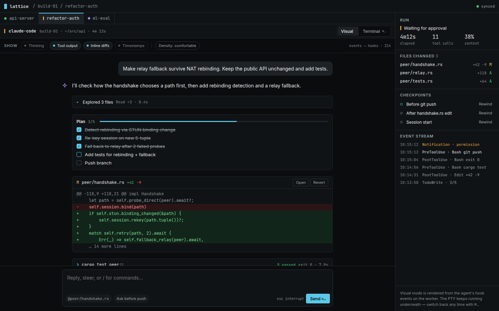

# Lattice

A peer-to-peer terminal for engineers who live in the shell.

- **Workers** run your processes: shells, dev servers, coding agents (claude-code, codex, …).
- **Decks** show and steer them: macOS and iOS.
- Nodes talk end-to-end encrypted over QUIC, relay first, then direct. No account, no trusted server.
- Everything syncs as streams. Features are WASM apps. Layouts are data.

> Early stage: specs lead, code follows. The screenshots below are design mockups, not the running app.

## Workspace

Sessions, panes, a coding agent waiting for approval, and the Git panel for one worker.


## Coding agents

An agent runs in a real PTY on the worker. The deck shows it as a terminal (TTY) or as a structured view (Visual) built from the agent's hook events.



All agents in a session, with pending approvals, todos, commands, and files touched.


## Mobile

The same sessions on a phone: terminal with a key bar, and the agent view with one-tap approval.


## Docs

| Area | Start here |
|---|---|
| Product and glossary | [docs/specs/00-overview.md](docs/specs/00-overview.md) |
| Platform architecture | [docs/architecture/README.md](docs/architecture/README.md) |
| Feature specs | [docs/specs/](docs/specs/) |
| Design system | [docs/design-system/README.md](docs/design-system/README.md) |
| Working rules | [AGENTS.md](AGENTS.md), [.rules/](.rules/) |

Design sources of truth: the [design canvas](https://claude.ai/artifact/XgswugNGzHbdYaWjpYDDhe) and the [simulator](https://claude.ai/artifact/5rwS5TZeyK6fziD1YRM8ak).

## Contributing

PRs only, rebase merge, Conventional Commits on every commit. See [.rules/engineering.md](.rules/engineering.md).

```sh
git config core.hooksPath .githooks
cargo fmt --all --check
cargo clippy --all-targets --all-features --locked -- -D warnings
cargo test --all-features --locked
```
