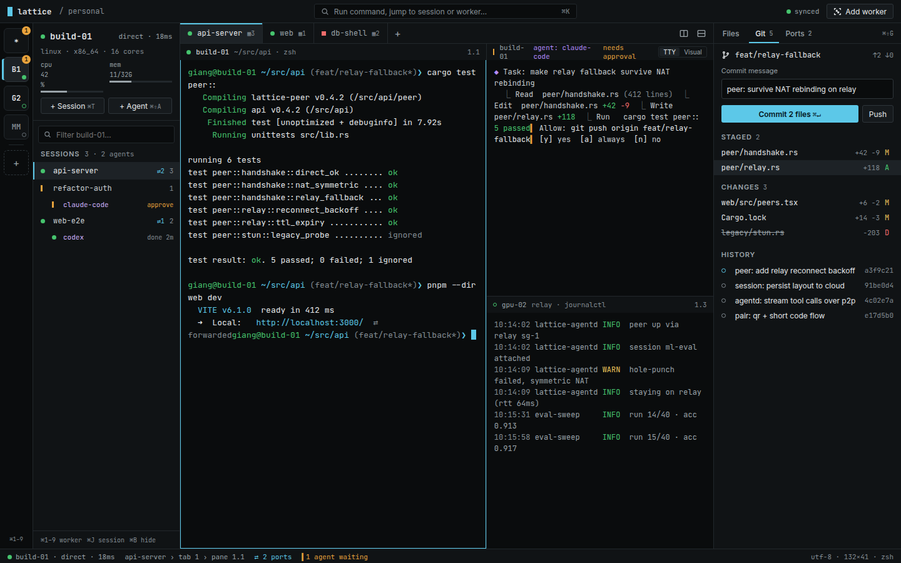
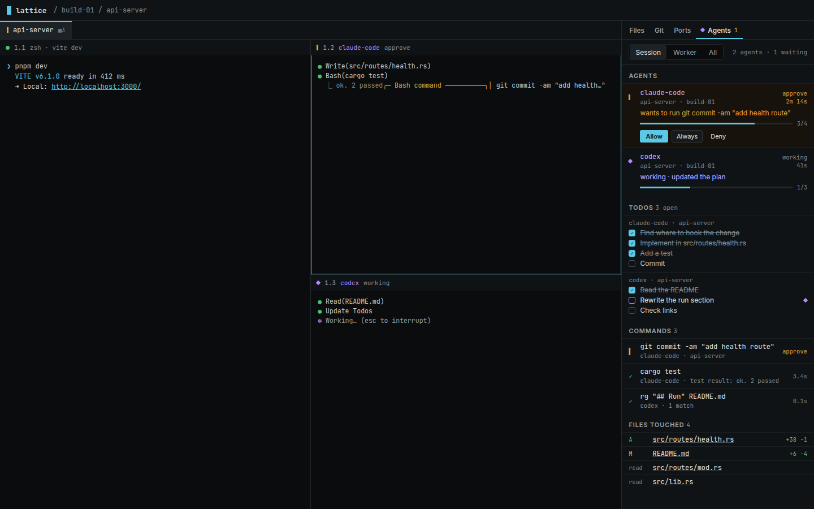
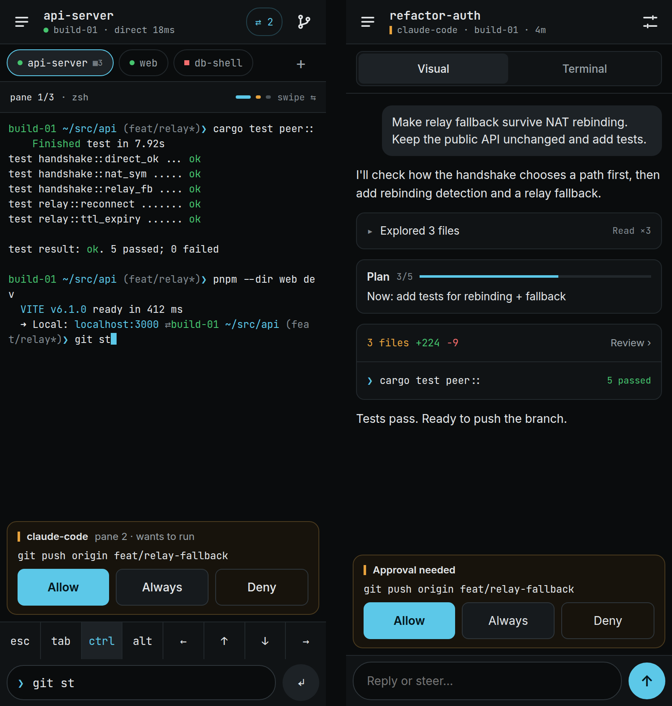

# Lattice

A peer-to-peer terminal for engineers who live in the shell.

- **Workers** run your processes: shells, dev servers, coding agents (claude-code, codex, …).
- **Decks** show and steer them: macOS and iOS.
- Nodes talk end-to-end encrypted over QUIC, relay first, then direct. No account, no trusted server.
- Everything syncs as streams. Features are WASM apps. Layouts are data.

> Early stage: specs lead, code follows. The screenshots below are design mockups, not the running app.

## Workspace

Sessions, panes, a coding agent waiting for approval, and the Git panel for one worker.



## Coding agents

An agent runs in a real PTY on the worker. The deck shows it as a terminal (TTY) or as a structured view (Visual) built from the agent's hook events.


All agents in a session, with pending approvals, todos, commands, and files touched.



## Mobile

The same sessions on a phone: terminal with a key bar, and the agent view with one-tap approval.



## Docs

| Area | Start here |
|---|---|
| Product and glossary | [docs/specs/00-overview.md](docs/specs/00-overview.md) |
| Platform architecture | [docs/architecture/README.md](docs/architecture/README.md) |
| Feature specs | [docs/specs/](docs/specs/) |
| Design system | [docs/design-system/README.md](docs/design-system/README.md) |
| Working rules | [AGENTS.md](AGENTS.md), [.rules/](.rules/) |

Design sources of truth: the [design canvas](https://claude.ai/artifact/XgswugNGzHbdYaWjpYDDhe) and the [simulator](https://claude.ai/artifact/5rwS5TZeyK6fziD1YRM8ak).

## Install

Prebuilt from GitHub releases: `latest` is the newest `vX.Y.Z`, `dev` is a rolling build of `main`. The script picks the build for the machine it runs on and checks its sha256.

```sh
curl -fsSL https://raw.githubusercontent.com/idnwit/lattice/main/install.sh | sh -s -- worker
```

| Component | Installs | Platforms |
|---|---|---|
| `worker` (default) | `latticed`, `latticed-proc`, `lattice` into `~/.local/bin` | Linux x86_64 and aarch64 (static musl), macOS x86_64 and arm64 |
| `relay` | `lattice-relay` into `~/.local/bin` | same |
| `deck` | `Lattice.app` into `~/Applications` | macOS arm64 |
| `all` | all of the above that the platform has | |

Options: `--version dev|latest|vX.Y.Z`, `--bin-dir DIR`, `--app-dir DIR`, `--dry-run`. The relay also ships as an image:

```sh
docker run -d -p 7400:7400/udp -v lattice-relay:/data ghcr.io/idnwit/lattice-relay:latest
```

Builds come from `.github/workflows/release-artifacts.yml`.

## Try the M1 PoC (macOS)

A local worker and the deck, loopback only (experiment mode):

```sh
cargo run -p latticed-proc &                 # PTYs and journals
cargo run -p latticed &                      # worker: fetches app packages from the deck
LATTICE_DECK_LIVE=1 cargo run -p lattice-deck
```

Pick Terminal or Echo, `⌘D` / `⌘⇧D` to split (a split opens the app picker), `⌘W` to close.
Apps are WASM packages built from [apps/](apps/) and embedded in the deck (D42–D44).

## Third-party assets and licenses

The deck bundles fonts so terminals look the same on every machine
([crates/lattice-deck-ui/fonts/](crates/lattice-deck-ui/fonts/README.md)):

| Asset | Version | License | Notes |
|---|---|---|---|
| [JetBrains Mono](https://github.com/JetBrains/JetBrainsMono) (Regular, Medium, Bold, Italic; WOFF2) | 2.304 | SIL Open Font License 1.1 ([text](crates/lattice-deck-ui/fonts/OFL-JetBrainsMono.txt)) | The `mono` font of the design system |
| [Symbols Nerd Font Mono](https://github.com/ryanoasis/nerd-fonts) (symbols only) | 3.4.0 | MIT ([text](crates/lattice-deck-ui/fonts/LICENSE-NerdFonts.txt)) | Fallback for prompt icons (Private Use Area). The icon sets inside keep their upstream licenses (Font Awesome, Material Design Icons, Devicons, Octicons, …); see the Nerd Fonts [license notes](https://github.com/ryanoasis/nerd-fonts/blob/master/LICENSE) |

Rust crates keep their own licenses (`Cargo.lock` lists them). TBD: the license of Lattice itself; a `cargo deny` license gate.

## Contributing

PRs only, rebase merge, Conventional Commits on every commit. See [.rules/engineering.md](.rules/engineering.md).

```sh
git config core.hooksPath .githooks
cargo fmt --all --check
cargo clippy --all-targets --all-features --locked -- -D warnings
cargo test --all-features --locked
```
